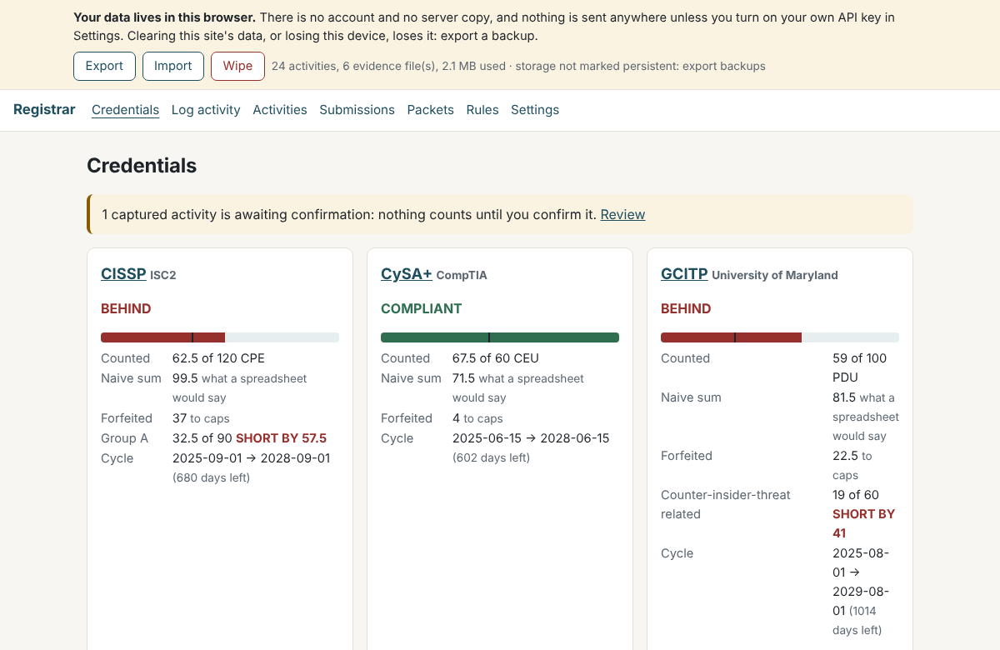
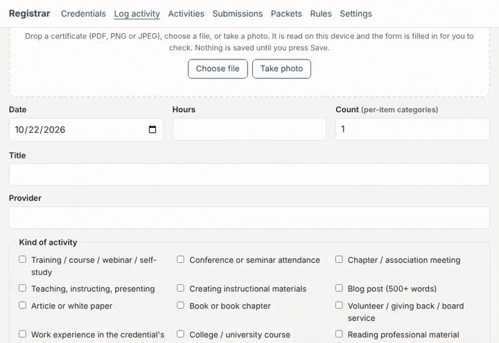
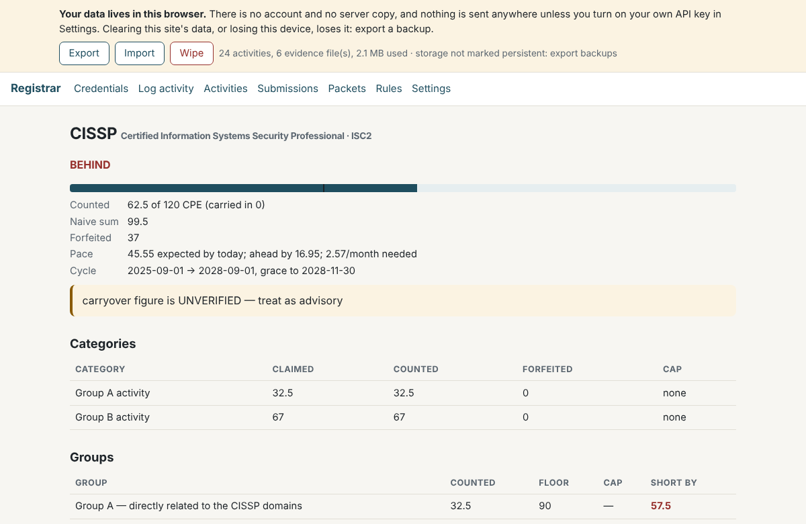

# Registrar

**Track your CPEs, CEUs and PDUs in one place, with the arithmetic each
certifying body actually uses.**

Registrar is a continuing-education tracker for people who hold one or
more professional certifications. It runs in your browser, with nothing to
install, or self-hosted on your own machine. It is tool #1 of
[ceu.tools](https://ceu.tools). It is an **early release**: usable, tested,
and honest about what it does not yet know.

(The Python package is called `cpebot`, its name before release.)



## Try it in your browser

**<https://ceu.tools/app>**: nothing to install, no account, and your
ledger and evidence stay in your browser.

- **First run** asks which credentials you hold. Everything after that
  follows from the answer, and you can skip it.
- **Load sample data** to look around first: three credentials and nine
  invented activities with certificates, all marked SAMPLE and removed in
  one click.
- **Drop a certificate** (PDF or photo) on Log activity. The date, hours,
  provider and title are read on your device and filled in for you to
  check; nothing is saved until you confirm. The empty ledger links a
  sample certificate to try it with.

  

- **Reports**: activities as CSV, a workbook (.xlsx) with Activities,
  Evidence and Totals sheets, and a calendar (.ics) of your cycle ends with
  alerts 90 and 30 days before. **Export** / **Import** move the whole
  ledger, evidence included, between browsers and to or from the
  self-hosted app.



How it works and what it sends where: [webapp/README.md](webapp/README.md)
and <https://ceu.tools/privacy>.

## Self-host it

The same rules and ledger as a small web app on your own machine or
private network, on the Python 3 standard library: no third-party
packages, no JavaScript, bound to localhost by default.

```bash
git clone https://github.com/robknowles-cybersecurity/registrar.git
cd registrar
cp .env.example .env && docker compose up -d --build     # or see Quickstart below
```

Then open <http://127.0.0.1:8762/>. Without Docker, see
[Quickstart](#quickstart) and [Self-hosting](#self-hosting) below;
[docs/SELF-HOST.md](docs/SELF-HOST.md) has the details. The self-hosted app
adds optional Telegram capture with your own bot, a renewal report and
quiet reminders.

## Why you can trust it

- **No accounts, no server, your data in your browser.** The browser app
  keeps every activity, setting and certificate in your browser's own
  storage on your device. ceu.tools has no account system, no database and
  no analytics, so there is no copy of your ledger anywhere else to leak
  (and none to restore it from: Export regularly). The only optional
  feature that sends anything is bring-your-own-key, and it sends the text
  of one certificate to the provider you chose, when you press the button;
  [the privacy page](https://ceu.tools/privacy) says exactly what.
- **Every third-party file is pinned by hash, and the build refuses on a
  mismatch.** The browser app uses two libraries, pdf.js and tesseract.js,
  served from ceu.tools itself, never from a CDN. Each file is vendored at
  an exact version with its SHA-256 recorded in
  `webapp/src/vendor/MANIFEST.json` and
  [docs/DEPENDENCIES.md](docs/DEPENDENCIES.md); `npm run build` re-hashes
  every one and stops if a single byte differs. The site's
  Content-Security-Policy lets the page run scripts and make connections
  only on its own origin, plus the two optional AI provider hosts and localhost.
- **Private vulnerability reporting is on.** Report security problems
  privately through GitHub (the *Security* tab, then *Report a
  vulnerability*); see [SECURITY.md](SECURITY.md) and
  <https://ceu.tools/.well-known/security.txt>.
- **The promises are tested, and the tests are tested.** Headless-browser
  checks run the built app under its real security policy and fail on any
  request that leaves the site; deliberately broken builds must make them
  fail, and do. See [Verifying](#verifying).
- **Registrar never asks for your certifying body's portal login.** It
  fills in packets; you submit them yourself.

## Why not a spreadsheet

Every body counts differently, and a sum of hours is wrong in the direction
that costs you the credential. A worked example:

You hold a CISSP: 120 CPEs over three years. You have logged 80 hours of
domain-related training and 40 hours of general professional development.
A spreadsheet says 120 of 120, done. Registrar says:

```
Earned          110 of 120 CPE
Naive sum       120           ← what the spreadsheet shows
Forfeited        10           ← Group B is capped at 30
Group A          80 of 90     SHORT BY 10   ← general hours will not fix this
Verdict         BEHIND
```

Two rules fire at once: ISC2 caps Group B at 30 and requires at least 90 in
Group A. The ten CPEs you still need are not interchangeable with the ten
you have. Every screen shows the counted total next to the naive one,
because the difference between them is the point.

Other bodies break the sum in other ways: CompTIA caps by activity type,
EC-Council requires each calendar year's credits to be registered by
1 February, ACFE's ethics minimum sits inside its fraud minimum, UMD's
GCITP splits by topic. The rules for each live in one data file,
`bodies.yaml`, with a source link and verification date on every number.

## What it does

- **Capture fast, confirm deliberately.** Log from a web form or, optionally,
  Telegram (`8h Threat modelling workshop #training @domain_security`). A
  capture is a claim until you confirm it; nothing counts on its own.
- **Cap- and minimum-aware totals** per credential, with forfeited hours
  stated and a pace line on every bar.
- **Evidence with hashes.** Every attached file is sha256'd when it arrives
  and re-checked on demand. A file that no longer matches is refused, not
  served.
- **Deadline calendar.** One `.ics` file with cycle ends, grace periods,
  registration windows, mid-cycle minimums and fees for every credential you
  track. Import it into any calendar; re-importing updates rather than
  duplicates.
- **Submission packets.** For each activity, your body's form fields in the
  form's order with the values filled in, ready to copy, plus a zip of your
  evidence with a manifest. **You sign in to the body's portal and submit
  yourself; Registrar never asks for, stores or uses your portal login.**
  Body form layouts are data files in `packetmaps/`; v1 ships a generic
  layout and an ISC2 one.
- **Renewal report** with position, gap, pace, evidence completeness,
  submitted-versus-logged and fees.
- **Quiet reminders**: at most one unsolicited message a day, only when you
  are behind or something is overdue.
- **Nothing is deleted.** Edits create a new version that supersedes the
  old; mistakes are voided, kept on record and never counted.
- **Exports** of the whole ledger (CSV, JSON), per-credential cycles, and a
  what-if calculator that writes nothing.

## Units

Each body keeps its own name for its unit, and so does Registrar: CISSP
progress is in CPEs, CySA+ in CEUs, GCITP in PDUs. Internally there is one
unit, the credit, and each credential declares its label and how activities
convert (one per hour, or a flat amount per item).

| Credential | Body | Unit | Cycle | Requirement | Rules verified (2026-10-20) |
|---|---|---|---|---|---|
| CISSP | ISC2 | CPE | 36 months | 120 (≥90 Group A, ≤30 Group B) | yes; rollover UNVERIFIED |
| CySA+ | CompTIA | CEU | 36 months | 60 | yes |
| CEH | EC-Council | CPE | 36 months | 120, registered yearly | yes |
| GCITP | University of Maryland | PDU | 48 months | 100 (≥60 C-InT) | yes; rollover UNVERIFIED |
| ATAP membership | ATAP | meeting | calendar year | 1 | **no** |
| CTM | ATAP | credit | 24 months | 50 | **no** (last checked 2026-08-30); category caps unknown |
| CFE | ACFE | CPE | 12 months | 20 (≥10 fraud, ≥2 ethics) | yes |

Some of these rules could not be confirmed against the body's own pages
when they were last checked. They are marked UNVERIFIED in the file and on
every screen. Where a body's category caps are not known at all (CTM),
Registrar refuses to give a compliance verdict and labels the credential
advisory only. Always check against your body's portal: it is
authoritative.

## Quickstart

Needs Python 3 (developed and tested on 3.13). Nothing to install: the standard library is
enough.

```bash
git clone https://github.com/robknowles-cybersecurity/registrar.git
cd registrar
python3 tools/demo.py --db var/demo.db        # fictional sample data
CPEBOT_DB=$PWD/var/demo.db CPEBOT_EVIDENCE=$PWD/var/evidence \
  python3 -m cpebot.web
```

Then open <http://127.0.0.1:8762/>. For a clean start, use
`tools/demo.py --db var/registrar.db --empty`, open Settings, and record
the date each of your credentials' cycles began.

Every sample row is invented and says so. Your own ledger and evidence are
your compliance record: keep them in `var/` (git-ignored) or outside the
checkout, and back them up.

## Self-hosting

With Docker: `cp .env.example .env && docker compose up -d --build`, then
open <http://127.0.0.1:8762/>. One container, your ledger in a named volume,
a health check, no secrets. Details: [docs/SELF-HOST.md](docs/SELF-HOST.md).

Without Docker, the environment variables are:

| Variable | Default | |
|---|---|---|
| `CPEBOT_BIND` | `127.0.0.1` | never `0.0.0.0` |
| `CPEBOT_PORT` | `8762` | |
| `CPEBOT_DB` | `~/cpebot/var/cpebot.db` | the ledger (SQLite) |
| `CPEBOT_EVIDENCE` | `~/cpebot/var/evidence` | attached files |
| `CPEBOT_BODIES` | `bodies.yaml` in the checkout | the rules |
| `CPEBOT_PACKETMAPS` | `packetmaps/` in the checkout | form layouts |
| `CPEBOT_ALLOWED_HOSTS` | empty | extra host names the web app answers to, comma-separated |

**Registrar has no login.** Bind it to loopback (the default) or to the
address of one private interface you already trust, such as a VPN or
overlay network, and never to a public interface. There the network is the
boundary; a second, weaker password in front of it would add something to
leak without keeping anyone out. There is no TLS and no rate limiting:
do not expose it to the internet.

The web app answers only to requests whose `Host` header (port ignored) is
`localhost`, `127.0.0.1`, `[::1]`, the bind address, or a name listed in
`CPEBOT_ALLOWED_HOSTS`; anything else gets `400 Bad Host header`. This stops
a web page on another site from reaching Registrar through your browser by
re-pointing its own domain name at your address (DNS rebinding). If you
reach Registrar by a name, for example `registrar.lan` or a VPN host name,
add that name: `CPEBOT_ALLOWED_HOSTS=registrar.lan`. An entry may carry a
port, which is ignored. An IPv6 address with a port must be bracketed,
`[fd00::2]:8762`; a bare `fd00::2:8762` is read as a different address.

For a service that survives reboots, `systemd/` has two **user** unit
templates. Replace the `<PLACEHOLDERS>` (each file's header lists them),
then:

```bash
install -m 0644 systemd/cpebot-web.service ~/.config/systemd/user/
systemctl --user daemon-reload
systemctl --user enable --now cpebot-web.service
loginctl enable-linger "$USER"     # start at boot without a login session
```

When bound to a private address, check the bind three ways:

```bash
ss -ltnp | grep 8762                                                    # <BIND_ADDRESS>, never 0.0.0.0
curl -s -o /dev/null -w '%{http_code}\n' http://<BIND_ADDRESS>:8762/    # 200
curl -s -o /dev/null -w '%{http_code}\n' http://127.0.0.1:8762/         # 000 (refused)
```

The last check is the one that catches a bind regression to `0.0.0.0`,
which would still pass the first two. `SERVICE.md` is a service card to
fill in for your own deployment.

## Telegram capture: bring your own bot

The Telegram bot is free and optional, and it ships **without a token**.
You create your own bot with Telegram's BotFather, store its token in a
`0600` file that git ignores, and lock the bot to your own chat id. Until
the token file exists the bot exits with an instruction and touches
nothing. Until a chat id is set, the bot refuses every chat and says so
when it starts. It logs the token and chat id only as their last four characters.

Step by step: [docs/TELEGRAM-SETUP.md](docs/TELEGRAM-SETUP.md).

## Deadlines and submission packets

In the web app: **Export → deadlines.ics**, and on each credential's page,
**Submit** (copy-ready fields per entry, evidence bundle, that credential's
deadlines). Routes: `/deadlines.ics[?credential=<id>]`,
`/packets/<id>[?unsubmitted=1]`, `/packets/<id>.zip`.

From the command line (same environment variables; global options go
before the command):

```bash
python3 -m cpebot ics --out deadlines.ics
python3 -m cpebot packet cissp --unsubmitted          # text, to stdout
python3 -m cpebot packet cissp --zip cissp-evidence.zip
python3 -m cpebot packetmaps                          # which layout each credential uses
python3 -m cpebot --db var/registrar.db ics --credential ceh
```

Fees in the calendar come from the fees you record in Settings. For a
credential with none recorded, the fees listed in `bodies.yaml` are placed
by their cadence and labelled as estimates.

The ISC2 packet layout is **unverified**: its field labels were drafted,
not read off the live form (the portal needs a member login). The values
are right; the labels may differ. Corrections go in `packetmaps/isc2.yaml`,
and `packetmaps/README.md` explains the format for adding another body.

## Verifying

```bash
bash tools/run_tests.sh                    # the full suite
python3 tools/prove_can_fail.py            # break it on purpose, 5 ways
python3 tools/verify_live.py http://127.0.0.1:8762   # against a demo ledger; it creates entries
```

`prove_can_fail.py` breaks five load-bearing protections in a copy of the
tree (CISSP's Group B cap, both VOID-exclusion guards, the CSRF gate, the
evidence bundle's hash check, the Host allowlist) and shows which tests
notice. A green suite
is only evidence once you have watched it go red for the right reason.
`docs/VERIFICATION.md` has the full account.

## Layout

```
bodies.yaml           the rules, as data, with provenance per field
packetmaps/           submission-form layouts, one file per body
cpebot/engine.py      cap- and minimum-aware assessment
cpebot/ledger.py      SQLite: entries, evidence, fees, reminders
cpebot/web.py         the web app (stdlib http.server, no JavaScript)
cpebot/ics.py         deadline calendar
cpebot/packets.py     per-entry submission packets and evidence bundle
cpebot/cli.py         python3 -m cpebot
cpebot/tgcapture.py   Telegram capture (bring your own token)
cpebot/report.py      renewal report and renewal packet
cpebot/reminders.py   when to speak, and mostly when not to
cpebot/validate.py    rules-based advisories (+ a disabled seam)
tools/                demo data, live verification, mutation proof
site/                 the ceu.tools landing page and /privacy (static, no scripts), the
                      share card and icons, security.txt, and site/app/, the built browser app
webapp/               the browser app's source, tests and build (webapp/README.md)
docs/                 Telegram setup, verification record, release notes (docs/release-notes/)
systemd/              user-unit templates
```

## Project

- [CHANGELOG.md](CHANGELOG.md): what changed in each release.
- Copyright (C) 2026 Rob Knowles. Licensed under the GNU Affero General
  Public License v3 (AGPL-3.0); see [LICENSE](LICENSE) and [NOTICE](NOTICE).
- [CONTRIBUTING.md](CONTRIBUTING.md): issues welcome; outside code
  contributions are not being accepted for now.
- [SECURITY.md](SECURITY.md): report vulnerabilities privately.
- [TRADEMARKS.md](TRADEMARKS.md): use of the Registrar and ceu.tools names,
  and certifying bodies' marks.
- [THIRDPARTY.md](THIRDPARTY.md): third-party code and assets (none).
- [COMMERCIAL.md](COMMERCIAL.md): a hosted edition is planned.

Registrar is not affiliated with or endorsed by any certifying body.

Built with AI-assisted development.
